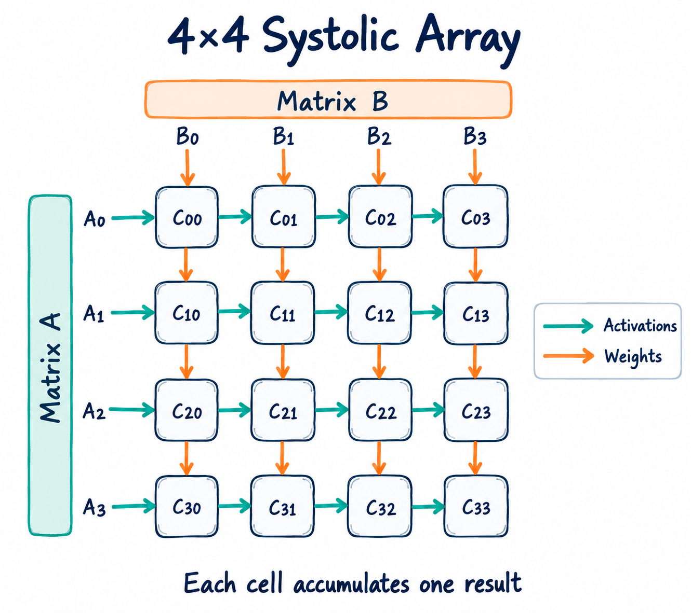
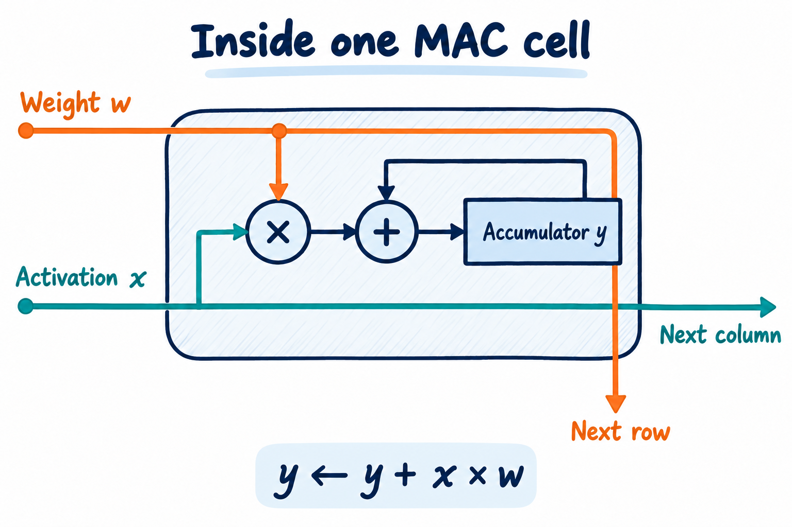
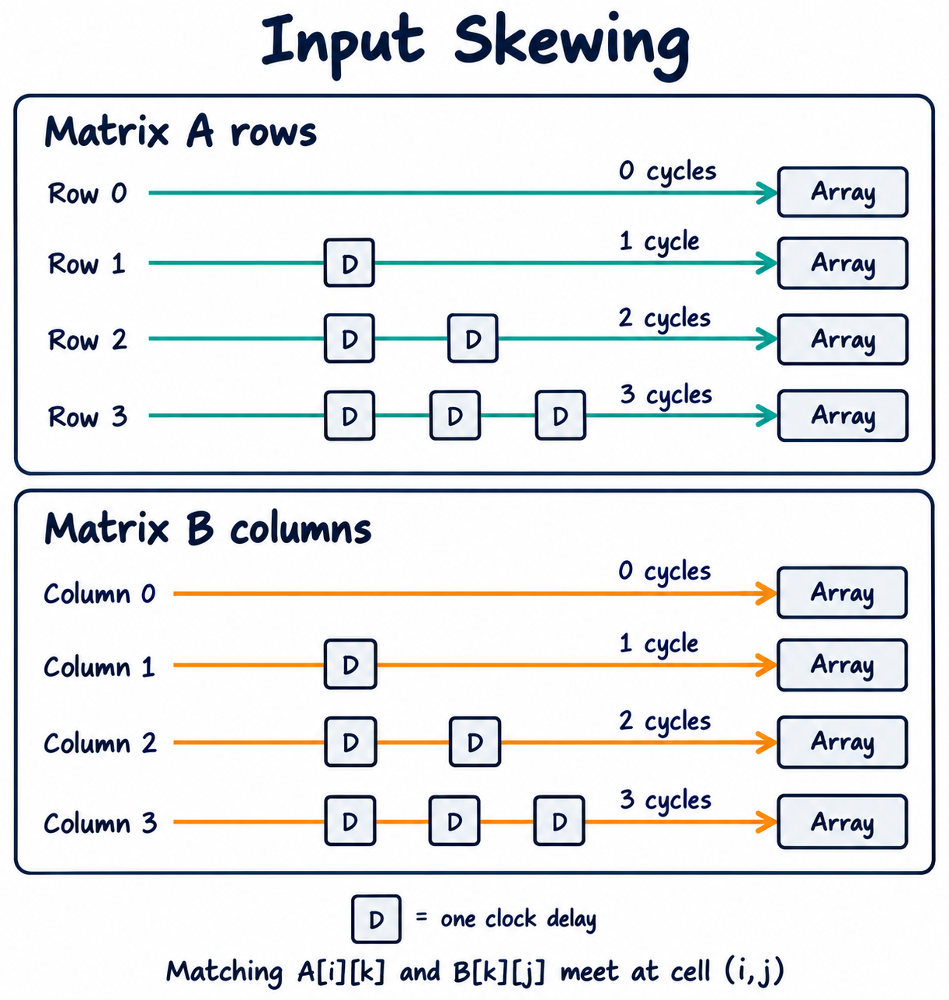
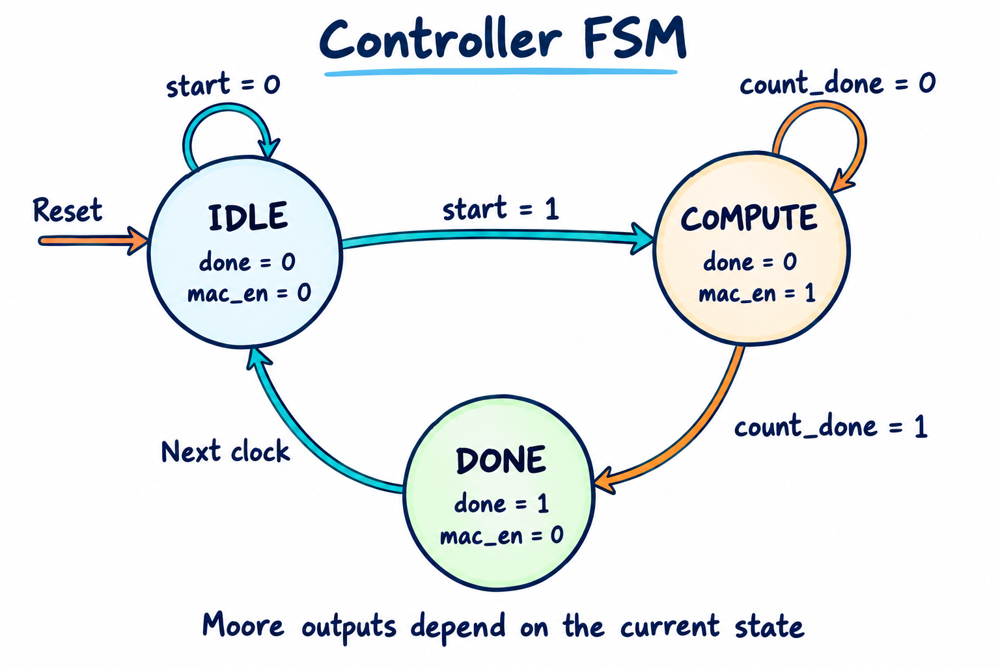
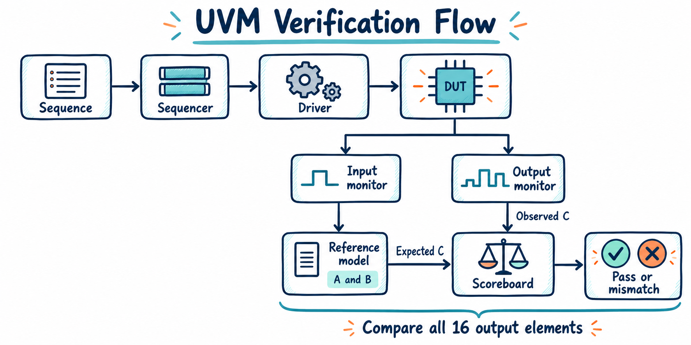

# 4×4 Systolic Array AI Accelerator

## SystemVerilog implementation with UVM verification

A 4×4 systolic array for matrix multiplication, implemented in SystemVerilog RTL. The design contains 16 multiply accumulate cells, input delay logic, and a controller that sequences computation. A UVM testbench generates matrix inputs and compares the hardware results against a reference model.

The accelerator computes:

```text
C = A × B

C[i][j] = Σ A[i][k] × B[k][j]
          k = 0 through 3
```

Each output element is the dot product of one row of A and one column of B. The complete operation requires 64 multiplications and their associated accumulations. The array distributes this work across 16 cells and reuses operands as they move between neighboring cells.

This README describes the architecture supplied with the project. Timing, reset behavior, and parameter support should be checked against the RTL before integration.

## Why use a systolic array?

Matrix multiplication is a central operation in many neural network layers. A systolic array maps its repeated arithmetic onto a regular grid of small processing elements.

Instead of independently fetching every operand for every output, a cell forwards each operand to its neighbor. An activation can contribute to multiple outputs as it travels across a row, while a weight can contribute to multiple outputs as it travels down a column.

The name systolic refers to this rhythmic movement: on each active clock edge, operands advance through the grid and cells update their local results. Cells become active at different times as the array fills, so all 16 cells do not perform useful arithmetic on every cycle.

## Architecture at a glance



The top module connects the input delay chains, processing cells, counter, and controller. Activations enter from the left boundary. Weights enter from the top boundary. Results remain inside the cells until external logic reads the output array.

## Output stationary dataflow

Each cell owns one output element throughout a matrix multiplication. Its partial sum stays in a local accumulator while the operands move through the array. This arrangement is called output stationary dataflow.



Conceptually, each enabled cell performs:

```systemverilog
y     <= y + (w_in * x_in);
x_out <= x_in;
w_out <= w_in;
```

The RTL determines whether forwarding is enabled independently or together with accumulation. The controller and driver must use a timing convention consistent with that behavior.

At cell `(i,j)`, the four useful operand pairs are:

```text
A[i][0] × B[0][j]
A[i][1] × B[1][j]
A[i][2] × B[2][j]
A[i][3] × B[3][j]
          ↓
        C[i][j]
```

For example, cell `(1,2)` computes:

```text
C[1][2] = A[1][0] × B[0][2]
        + A[1][1] × B[1][2]
        + A[1][2] × B[2][2]
        + A[1][3] × B[3][2]
```

## The 4×4 compute grid


Horizontal arrows carry A values. Vertical arrows carry B values. Each registered hop takes one clock cycle. The cell coordinates also identify the position of its result in matrix C.

## Input skewing and operand alignment



Operands must arrive together at the cell that multiplies them. Because cell `(i,j)` lies `j` horizontal hops from the left edge and `i` vertical hops from the top edge, the boundary streams need different delays.

1. Delay row `i` of A by `i` cycles.
2. Delay column `j` of B by `j` cycles.
3. Supply zeros in unused stream positions while the array fills and drains.

These delays ensure that `A[i][k]` and `B[k][j]` meet at cell `(i,j)` in arithmetic slot `k + i + j`.

Row 0 and column 0 enter directly. Row 1 and column 1 pass through one delay register. Row 2 and column 2 pass through two registers. Row 3 and column 3 pass through three registers.

The A streams at the array boundary are:

```text
Arithmetic slot   0    1    2    3    4    5    6

Row 0            A00  A01  A02  A03   0    0    0
Row 1             0   A10  A11  A12  A13   0    0
Row 2             0    0   A20  A21  A22  A23   0
Row 3             0    0    0   A30  A31  A32  A33
```

The corresponding B streams are:

```text
Arithmetic slot   0    1    2    3    4    5    6

Column 0         B00  B10  B20  B30   0    0    0
Column 1          0   B01  B11  B21  B31   0    0
Column 2          0    0   B02  B12  B22  B32   0
Column 3          0    0    0   B03  B13  B23  B33
```

If the top module provides these delays internally, the driver supplies the original matrix streams without adding the same delays again.

## Computation timing

Seven slots are sufficient to present all skewed operands at the array boundaries. The final operands still need time to reach the bottom right cell.

For the described registered dataflow, the last useful operation occurs at:

```text
Last slot = last k + last row + last column
          = 3 + 3 + 3
          = 9

Total arithmetic slots = 10
```

The first and last useful arithmetic slots for each cell are:

```text
                   Column 0   Column 1   Column 2   Column 3

Row 0                0…3        1…4        2…5        3…6
Row 1                1…4        2…5        3…6        4…7
Row 2                2…5        3…6        4…7        5…8
Row 3                3…6        4…7        5…8        6…9
```

For an `N × N` array multiplying two square matrices of the same size, this schedule uses `3N − 2` arithmetic slots. Interface sampling, initial input registers, and controller transitions can add latency around those slots.

A controller that ends computation when a counter reaches 6 therefore needs review against the actual RTL. Under the schedule above, it would stop before the final cells finish. `done` must indicate that every result is valid.

## RTL module responsibilities

### mac_cell

The processing element multiplies its two operands, adds the product to its accumulator, and forwards operands to neighboring cells. Sixteen instances form the grid.

The described interface uses 32 bit operands and a 64 bit accumulator. A full precision 32 bit multiplication fits in 64 bits, but a sum of four full range products can require 66 bits. A 64 bit accumulator therefore requires bounded inputs or an explicitly defined overflow policy.

Operand signedness and expression sizing also need to be consistent between the RTL and reference model.

### controller



A three state Moore FSM sequences a transaction. Its control outputs depend on the current state.

The controller waits in IDLE until `start` is asserted, enters COMPUTE, moves to DONE after `count_done`, then returns to IDLE on the following cycle.

```text
State       done       mac_en       Purpose

IDLE          0           0         Wait for a new request
COMPUTE       0           1         Advance the computation
DONE          1           0         Announce valid results
```

The intended DONE state lasts one cycle before returning to IDLE. External logic should capture results when `done` is asserted. Moore decoding makes outputs depend only on state; whether an output is explicitly registered depends on the implementation.

### top

The top module builds the datapath and connects control signals.

The top module contains the controller, computation counter, two sets of input delay chains, and the grid of 16 MAC cells.

The horizontal operand network has dimensions `x_wire[4][5]`. The vertical network has dimensions `w_wire[5][4]`. The extra boundary position allows every cell to connect to an input and an output.

```text
x_wire[i][j] → Cell(i,j) → x_wire[i][j+1]
w_wire[i][j] → Cell(i,j) → w_wire[i+1][j]
```

Nested generate loops express the repeated connections. Scaling the design also requires compatible array dimensions, delay depths, counter widths, completion timing, and verification logic.

## Transaction lifecycle

The transaction proceeds through initialization, start acceptance, operand streaming, array draining, completion, and result capture before the next operation.

Each transaction must begin with cleared accumulators and known delay contents. Otherwise, a later matrix multiplication can include results or operands from an earlier transaction. The exact reset or clear mechanism is defined by the RTL.

## Design choices

### Local result accumulation

Output stationary dataflow keeps partial sums close to the arithmetic that updates them. This avoids moving a partial result between cells after each multiplication. Other dataflows, including weight stationary designs, choose different reuse patterns based on the workload and memory system.

### Separate datapath and sequencing

The compute grid and delay chains express operand movement. The controller expresses when a transaction is active and when results are ready. Keeping these responsibilities separate makes timing and control easier to inspect.

### Repeated structure through generate loops

A nested generate loop captures the regular layout of the array and avoids manually wiring every instance. This provides a useful foundation for parameterization, although complete size independence requires more than changing loop bounds.

## UVM verification architecture

The testbench represents a matrix multiplication as a transaction containing A, B, and C. A sequence creates inputs, a driver converts them into signal activity, monitors observe the interface, and a scoreboard checks the observed result.



### Verification components

1. **systolic_transaction** holds the input and result matrices. The described random constraints limit input values to 0 through 15.
2. **systolic_sequence** creates randomized transactions. The documented default is 20 matrix multiplications per run.
3. **systolic_driver** presents the matrix streams, pulses `start`, and waits for completion before beginning another transaction.
4. **systolic_monitor_in** observes `start` and the input streams, reconstructs A and B, and publishes them to the scoreboard.
5. **systolic_monitor_out** captures all 16 results when `done` is observed.
6. **systolic_scoreboard** pairs observed inputs with outputs and compares each output element with the reference calculation.
7. **systolic_agent** groups the sequencer, driver, and input monitor.
8. **systolic_env** creates the agent, output monitor, and scoreboard and connects their analysis ports.
9. **systolic_test** creates the environment, runs the sequence, and manages the simulation objection.

### Reference model

The scoreboard independently computes the mathematical matrix product:

```text
For each row i:
    For each column j:
        expected[i][j] = 0
        For each shared index k:
            expected[i][j] += A[i][k] × B[k][j]

Compare all 16 expected values with the captured DUT outputs.
```

With values limited to 0 through 15, the largest output element is `4 × 15 × 15 = 900`. These inputs are useful for checking arithmetic and operand routing, but do not exercise full width arithmetic or overflow behavior.

Independent input observation helps the scoreboard check what was actually driven. Pairing input and output queues in order assumes transactions complete in order and that monitors capture exactly one record per operation.

### Useful verification scenarios

1. Zero matrices verify initialization and the absence of stale partial sums.
2. Identity matrices verify operand placement and result indexing.
3. A single nonzero element helps isolate a routing or alignment error.
4. Distinct values in each row and column help reveal transposed operands.
5. Consecutive transactions verify clearing between operations.
6. Reset during an operation checks recovery behavior.
7. Maximum supported values check width and overflow assumptions.
8. Completion timing checks that `done` follows the final accumulation.

These are suggested scenarios. Test results and coverage should be reported from actual simulation runs.

## Source organization

```text
systolic_array/
  ├─ images/
  │   ├─ array.png
  │   ├─ controller.png
  │   ├─ mac.png
  │   ├─ skewing.png
  │   └─ verification.png
  ├─ src/
  │   ├─ controller.sv
  │   ├─ mac_cell.sv
  │   └─ top.sv
  ├─ tests/
  │   ├─ run_uvm.sh
  │   ├─ run.sh
  │   └─ systolic_tb.sv
  ├─ uvm_testbench/
  │   ├─ files.f
  │   ├─ README.md
  │   ├─ systolic_agent.sv
  │   ├─ systolic_driver.sv
  │   ├─ systolic_env.sv
  │   ├─ systolic_if.sv
  │   ├─ systolic_monitor_in.sv
  │   ├─ systolic_monitor_out.sv
  │   ├─ systolic_pkg.sv
  │   ├─ systolic_scoreboard.sv
  │   ├─ systolic_sequence.sv
  │   ├─ systolic_smoke_test.sv
  │   ├─ systolic_tb.sv
  │   ├─ systolic_test.sv
  │   └─ systolic_transaction.sv
  └─ README.md
```
## Simulation workflow

1. Use a simulator with SystemVerilog and UVM support.
2. Compile the RTL, interface, verification classes, and testbench in dependency order.
3. Select `systolic_tb` as the simulation top and `systolic_test` as the UVM test.
4. Run the test and inspect scoreboard comparisons and UVM errors.
5. Inspect waveforms for input alignment, accumulator clearing, and completion timing.

Exact commands depend on the simulator and build files in the repository. This README does not claim measured frequency, area, power, coverage, or passing simulation results without corresponding reports.
